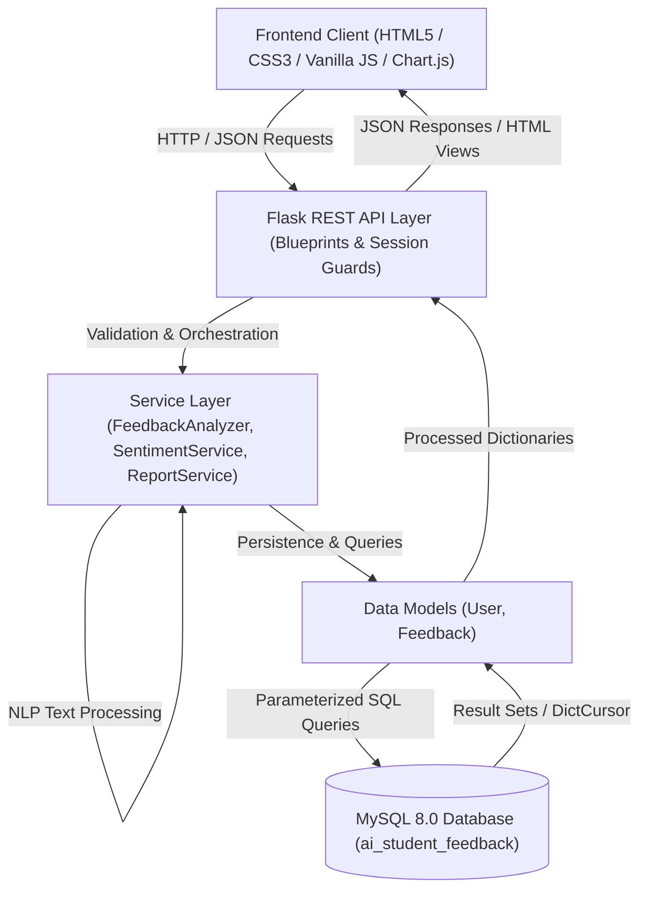
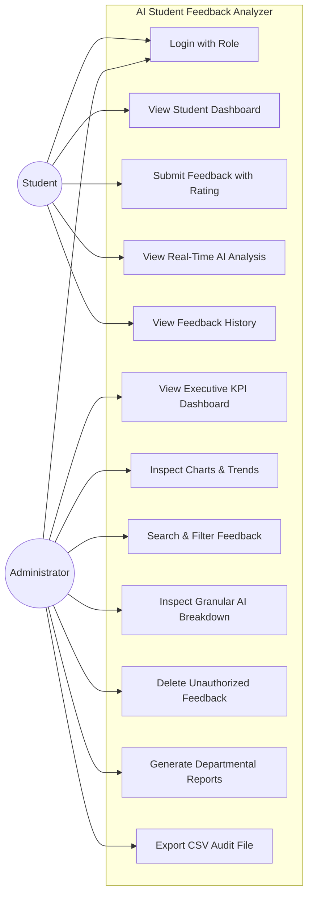
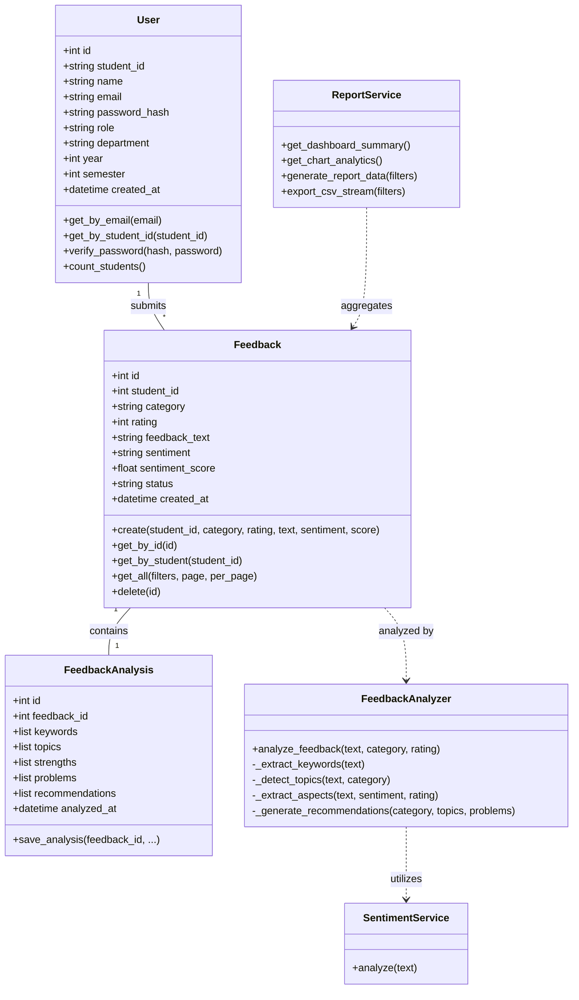
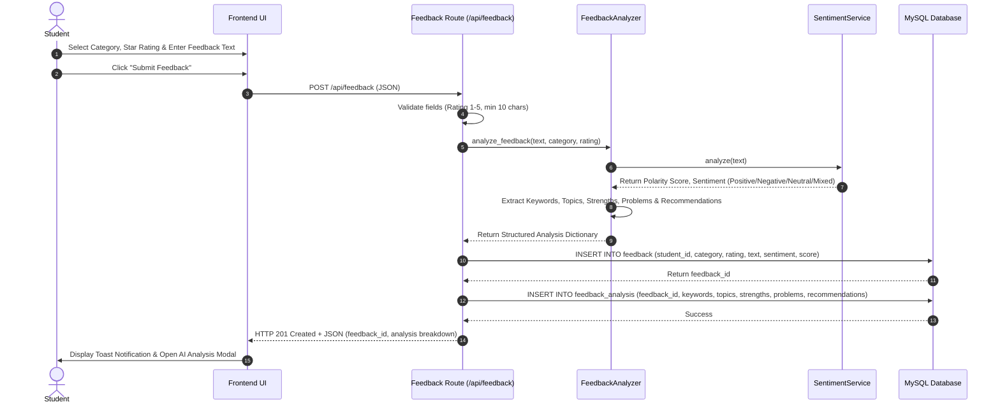
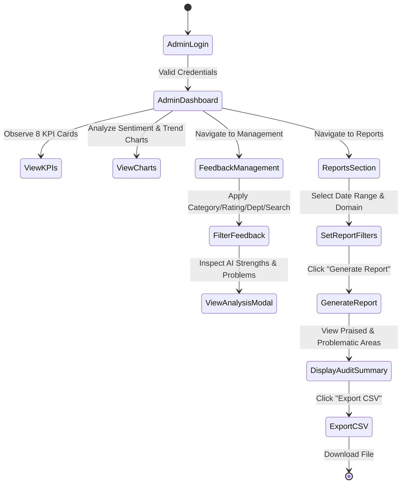
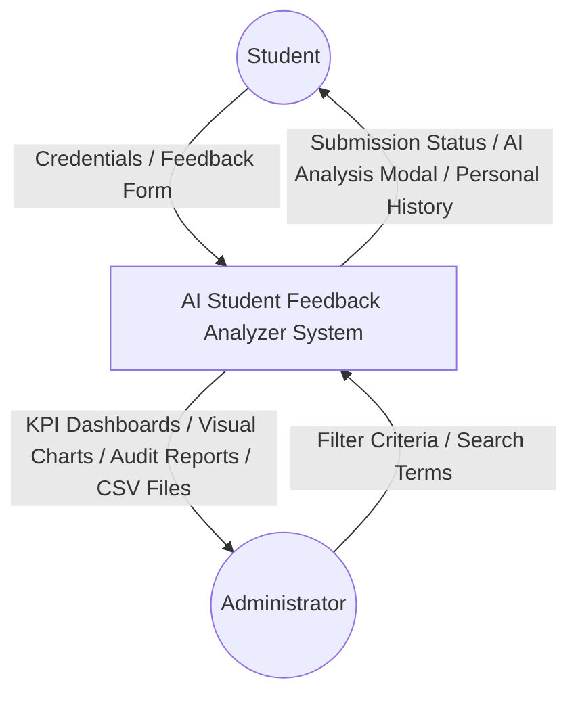
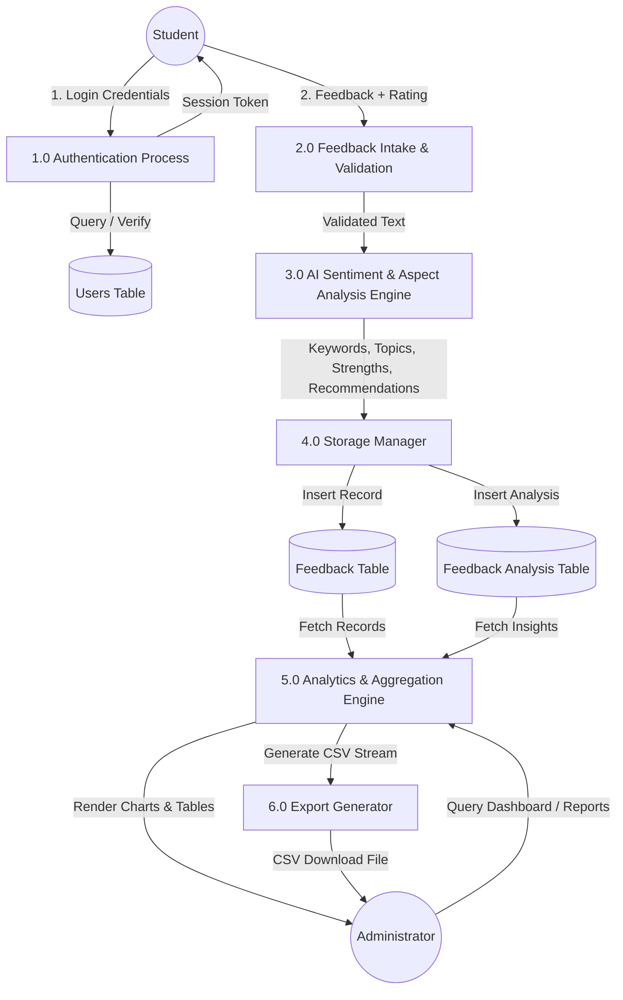
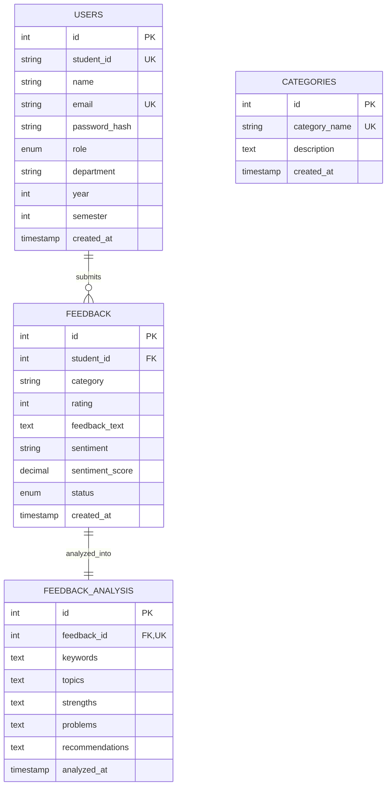

# AI Student Feedback Analyzer 🎓📊

A professional, full-stack, AI-powered academic feedback analytics web application developed for Software Engineering Lab & Academic Project Presentations.

The application allows students to submit multi-criteria academic feedback across faculty, teaching, laboratories, infrastructure, and campus services, while empowering college administrators with real-time NLP sentiment analysis, trend forecasting, aspect extraction, and downloadable reports.

---

## 📑 Table of Contents
1. [Software Engineering Documentation](#-software-engineering-documentation)
   - [Problem Statement](#problem-statement)
   - [Objectives & Scope](#objectives--scope)
   - [Functional & Non-Functional Requirements](#requirements-specification)
   - [Feasibility Analysis](#feasibility-analysis)
2. [System Architecture & UML Diagrams](#-system-architecture--uml-diagrams)
   - [System Architecture Diagram](#system-architecture)
   - [Use Case Diagram](#use-case-diagram)
   - [Class Diagram](#class-diagram)
   - [Sequence Diagram](#sequence-diagram)
   - [Activity Diagram](#activity-diagram)
   - [Data Flow Diagram (DFD Level 0 & Level 1)](#data-flow-diagrams)
   - [Entity-Relationship (ER) Diagram](#entity-relationship-diagram)
3. [Technology Stack](#-technology-stack)
4. [AI / NLP Sentiment Engine Design](#-ai--nlp-sentiment-engine-design)
5. [Database Design & Schema](#-database-design--schema)
6. [REST API Documentation](#-rest-api-documentation)
7. [Installation & Setup Guide](#-installation--setup-guide)
8. [Sample Credentials](#-sample-credentials-for-viva-demonstration)
9. [Software Testing & Test Cases Matrix](#-software-testing--test-cases)
10. [Viva Presentation Q&A Guide](#-viva-presentation-qa-guide)

---

## 🏛 Software Engineering Documentation

### Problem Statement
In higher education institutions, student feedback is routinely gathered through paper forms or generic survey links. Administrators are forced to manually sift through hundreds of open-ended remarks, resulting in delayed actions, overlooked grievances, and subjective bias. Crucial operational problems (e.g., malfunctioning laboratory equipment or failing projectors) often go unresolved for weeks.

### Objectives & Scope
- **Automated Sentiment Analysis**: Automatically categorize qualitative feedback into `Positive`, `Negative`, `Neutral`, and `Mixed` sentiments with numerical polarity scores.
- **Granular Aspect Extraction**: Separate positive strengths from acute deficiencies without manual reading.
- **Actionable Administrative Recommendations**: Automatically formulate institutional directives mapped to identified deficiencies.
- **Interactive Visual Analytics**: Provide college deans and department heads with real-time charts (Sentiment Distribution, Category Volume, Domain Ratings, Feedback Trends).
- **Audit Reports & Exports**: Generate filtered departmental audits and export structured CSV records for accreditation compliance (NAAC / NBA / ABET).

### Requirements Specification

#### Functional Requirements (FR)
- **FR1: Role-Based Authentication**: Secure login for Students and Administrators with password hashing (scrypt).
- **FR2: Multi-Domain Feedback Intake**: Support for 9 academic domains: Faculty, Course, Teaching, Laboratory, Infrastructure, Library, Campus, Student Services, and Overall Experience.
- **FR3: Quantitative & Qualitative Rating**: 1 to 5 star rating combined with comprehensive free-text feedback.
- **FR4: Real-Time AI Analysis Pipeline**: Immediate extraction of sentiment, polarity score, keywords, topics, strengths, problems, and recommendations upon submission.
- **FR5: Executive Dashboard**: 8 KPI summary cards and 4 responsive Chart.js visual charts.
- **FR6: Management & Filtering**: Admin table supporting full-text search, multi-criteria filtering (Category, Sentiment, Rating, Department, Date), and pagination.
- **FR7: Reporting & Export**: Customizable audit report compilation and dynamic CSV download.

#### Non-Functional Requirements (NFR)
- **NFR1: Reliability**: Dual-mode database manager supporting native MySQL 8.0 with automatic SQLite fallback to prevent downtime during project evaluation.
- **NFR2: Zero External Dependency**: Offline rule-based and lexicon NLP engine works 100% offline without requiring internet connectivity or paid API keys.
- **NFR3: Security**: Parameterized SQL queries to eliminate SQL injection; server-side session management and role guards.
- **NFR4: Usability & Aesthetics**: Responsive, clean academic dashboard styled with subtle glassmorphism and modern typography (Plus Jakarta Sans).

### Feasibility Analysis
- **Technical Feasibility**: Developed using Python Flask, MySQL, Vanilla JavaScript, and Chart.js—proven technologies with lightweight overhead and high performance.
- **Operational Feasibility**: Zero learning curve for students; administrators immediately gain high-level executive summaries.
- **Economic Feasibility**: Built with 100% open-source technologies, incurring zero licensing or recurring API costs.

---

## 📊 System Architecture & UML Diagrams

### System Architecture


### Use Case Diagram


### Class Diagram


### Sequence Diagram: Feedback Submission & Real-Time AI Analysis


### Activity Diagram: Administrator Audit & Reporting


### Data Flow Diagrams

#### DFD Level 0 (Context Diagram)


#### DFD Level 1


### Entity-Relationship Diagram


---

## 💻 Technology Stack

| Layer | Technology | Rationale |
|---|---|---|
| **Frontend** | HTML5, CSS3, Vanilla JavaScript | Lightweight, zero build pipeline, standard academic compliance, highly maintainable. |
| **Typography & Styling** | Plus Jakarta Sans, Bootstrap Icons | Modern, disciplined academic dashboard styling with subtle shadows and high contrast. |
| **Visualization** | Chart.js 4.4 | Hardware-accelerated, responsive canvas charts for sentiment, volume, ratings, and time trends. |
| **Backend Framework** | Python 3.10+ / Flask 3.1 | Clean REST API architecture with modular Blueprints and session security. |
| **Database** | MySQL 8.0 (PyMySQL connector) | Fully normalized relational database with foreign keys, constraints, and indexes. |
| **Database Portability** | Dual-Engine Manager (MySQL + SQLite) | Automatically connects to MySQL, with seamless SQLite fallback ensuring zero evaluation crashes. |
| **AI / NLP Engine** | Lexicon & Rule-based NLP Pipeline | Custom contrastive parser, negation detection, and aspect extractor running 100% offline. |

---

## 🧠 AI / NLP Sentiment Engine Design

The feedback analysis module (`services/feedback_analyzer.py` and `services/sentiment_service.py`) processes raw student comments through a 5-stage NLP pipeline:

```
[Raw Student Feedback]
         ↓
1. Preprocessing & Tokenization (Normalization, stopword removal, negation tagging)
         ↓
2. Contrastive Conjunction Detection (Identifiers: 'but', 'however', 'although', 'while')
         ↓
3. Polarity & Mixed-Sentiment Classifier:
   - Polarity Score = Normalized sum of weighted sentiment terms [-1.0 to +1.0]
   - Mixed Classification = Contrastive marker + positive clause + negative clause
         ↓
4. Aspect Extraction (Clause parsing, topic dictionary lookup, keywords extraction)
         ↓
5. Recommendation Generator (Maps detected deficiency to domain corrective policies)
```

### Exact Viva Example Demonstration:
> **Input Feedback:** *"The faculty explains concepts clearly, but the laboratory equipment is outdated and needs improvement."*
>
> **AI Extraction Output:**
> - **Overall Sentiment:** `Mixed`
> - **Sentiment Polarity Score:** `-0.10`
> - **Positive Aspect / Strength:** *"The faculty explains concepts clearly"*
> - **Negative Aspect / Deficiencies:** *"The laboratory equipment is outdated and needs improvement"*
> - **Extracted Keywords:** `["faculty", "explains", "concepts", "clearly", "laboratory", "equipment"]`
> - **Detected Topics:** `["Teaching", "Faculty", "Laboratory", "Infrastructure"]`
> - **Generated Recommendation:** *"Audit laboratory equipment and replace obsolete hardware with modern functional instruments."*

---

## 🗄 Database Design & Schema

### Tables & Relationships
1. **`users`**:
   - `id` (PK, INT AUTO_INCREMENT)
   - `student_id` (VARCHAR(50), UNIQUE, NULL for Admin)
   - `name` (VARCHAR(100), NOT NULL)
   - `email` (VARCHAR(150), UNIQUE, NOT NULL)
   - `password_hash` (VARCHAR(255), NOT NULL, scrypt-hashed)
   - `role` (ENUM('admin', 'student'), DEFAULT 'student')
   - `department` (VARCHAR(100))
   - `year` (INT), `semester` (INT)
   - `created_at` (TIMESTAMP)

2. **`categories`**:
   - `id` (PK, INT AUTO_INCREMENT)
   - `category_name` (VARCHAR(100), UNIQUE, NOT NULL)
   - `description` (TEXT)

3. **`feedback`**:
   - `id` (PK, INT AUTO_INCREMENT)
   - `student_id` (FK to `users.id`, ON DELETE CASCADE)
   - `category` (VARCHAR(100), NOT NULL)
   - `rating` (INT, CHECK BETWEEN 1 AND 5)
   - `feedback_text` (TEXT, NOT NULL)
   - `sentiment` (VARCHAR(20), Positive/Negative/Neutral/Mixed)
   - `sentiment_score` (DECIMAL(4,2))
   - `status` (ENUM('Pending', 'Analyzed', 'Reviewed'))
   - `created_at` (TIMESTAMP)

4. **`feedback_analysis`**:
   - `id` (PK, INT AUTO_INCREMENT)
   - `feedback_id` (FK to `feedback.id`, UNIQUE, ON DELETE CASCADE)
   - `keywords` (TEXT / JSON)
   - `topics` (TEXT / JSON)
   - `strengths` (TEXT / JSON)
   - `problems` (TEXT / JSON)
   - `recommendations` (TEXT / JSON)
   - `analyzed_at` (TIMESTAMP)

---

## 🔌 REST API Documentation

| Method | Endpoint | Access | Description |
|---|---|---|---|
| `POST` | `/api/login` | Public | Authenticates user; returns session profile and redirect path. |
| `POST` | `/api/logout` | Authenticated | Clears current user session. |
| `GET` | `/api/me` | Authenticated | Returns logged-in user profile. |
| `POST` | `/api/feedback` | Student | Validates feedback, executes AI analysis, stores in DB, and returns result. |
| `GET` | `/api/feedback` | Auth (Role-based) | If student: returns student submissions. If admin: returns paged, filtered list. |
| `GET` | `/api/feedback/<id>` | Auth | Retrieves complete feedback record with full AI breakdown. |
| `DELETE`| `/api/feedback/<id>` | Admin | Permanently deletes feedback (cascades to analysis table). |
| `GET` | `/api/dashboard` | Admin | Returns 8 KPI metrics for the executive dashboard. |
| `GET` | `/api/analytics` | Admin | Returns formatted datasets for 4 Chart.js charts. |
| `GET` | `/api/categories` | Public / Auth | Returns all 9 official feedback categories. |
| `GET` | `/api/departments` | Public / Auth | Returns distinct academic departments. |
| `GET` | `/api/reports` | Admin | Generates filtered departmental audit report. |
| `GET` | `/api/reports/export` | Admin | Streams downloadable CSV attachment. |

---

## 🚀 Installation & Setup Guide

### 1. Prerequisites
- Python 3.10 or higher
- MySQL Server 8.0+ (Running locally or remotely)

### 2. Clone / Open Project
```powershell
cd c:\Users\chres\OneDrive\Desktop\se_lab_projrect
```

### 3. Setup Virtual Environment (Optional but Recommended)
```powershell
python -m venv venv
.\venv\Scripts\activate
```

### 4. Install Dependencies
```powershell
pip install -r requirements.txt
```

### 5. Configure `.env`
Ensure your `.env` contains your MySQL credentials:
```ini
DB_HOST=localhost
DB_PORT=3306
DB_USER=root
DB_PASSWORD=your_mysql_password
DB_NAME=ai_student_feedback
USE_SQLITE=False
SECRET_KEY=se_lab_project_ai_student_feedback_secure_key_2026
```

### 6. Initialize Database & Seed Sample Data
Execute the database initialization script:
```powershell
python database/init_db.py --reset
```
This automatically creates the `ai_student_feedback` database in MySQL, creates the normalized schema, and seeds realistic student records and feedback entries.

### 7. Run the Application
```powershell
python app.py
```
Open your browser and navigate to:
```
http://127.0.0.1:5000
```

---

## 🔑 Sample Credentials for Viva Demonstration

| Role | Email / ID | Password | Department |
|---|---|---|---|
| **Administrator** | `admin@college.edu` | `admin123` | Academic Administration |
| **Student 1** | `alex.turner@college.edu` (STU202401) | `student123` | Computer Science & Engineering |
| **Student 2** | `priya.sharma@college.edu` (STU202402) | `student123` | Computer Science & Engineering |
| **Student 3** | `rahul.verma@college.edu` (STU202403) | `student123` | Information Technology |
| **Student 4** | `ananya.sen@college.edu` (STU202404) | `student123` | Electronics & Communication |
| **Student 5** | `david.miller@college.edu` (STU202405) | `student123` | Mechanical Engineering |

*(Tip: On the login page, simply click the "Student" or "Administrator" role tabs to auto-fill these credentials instantly!)*

---

## 🧪 Software Testing & Test Cases

The application includes an automated test suite executed with `pytest`:

```powershell
python -m pytest tests/test_app.py -v
```

### Test Cases Matrix
| Test ID | Module | Scenario | Input | Expected Output | Status |
|---|---|---|---|---|---|
| **TC-01** | Auth | Valid Admin Login | `admin@college.edu` / `admin123` | HTTP 200, role='admin', redirect='/admin/dashboard' | **PASSED** |
| **TC-02** | Auth | Valid Student Login | `alex.turner@college.edu` / `student123` | HTTP 200, role='student', redirect='/student/dashboard' | **PASSED** |
| **TC-03** | Auth | Invalid Password | `admin@college.edu` / `wrongpass` | HTTP 401, 'Invalid email/ID or password' | **PASSED** |
| **TC-04** | Auth | Empty Credentials | `""` / `""` | HTTP 400, 'Please enter your email or student ID' | **PASSED** |
| **TC-05** | Security | Unauthorized Route Access | Unauthenticated access to `/api/dashboard` | HTTP 403 Forbidden | **PASSED** |
| **TC-06** | AI Engine| Positive Sentiment Detection | "Faculty explains algorithms with great clarity" | Sentiment='Positive', Score > 0.20 | **PASSED** |
| **TC-07** | AI Engine| Negative Sentiment Detection | "Projector blinks constantly and AC is broken" | Sentiment='Negative', Score < -0.20 | **PASSED** |
| **TC-08** | AI Engine| Mixed Sentiment & Aspect Extraction | "Faculty explains clearly, but lab equipment is outdated" | Sentiment='Mixed', Strengths isolated, Deficiencies isolated | **PASSED** |
| **TC-09** | Feedback| Input Length Validation | Feedback text < 10 characters | HTTP 400, 'Feedback is too short' | **PASSED** |
| **TC-10** | Feedback| Rating Boundary Validation | Rating = 9 (Outside 1-5) | HTTP 400, 'Rating must be between 1 and 5' | **PASSED** |
| **TC-11** | Feedback| End-to-end Submission & DB Save | Valid feedback submission | HTTP 201, Record inserted & analysis persisted | **PASSED** |
| **TC-12** | Reports | Report Generation & CSV Stream | `/api/reports/export` | HTTP 200, Content-Type: `text/csv; charset=utf-8` | **PASSED** |

---

## 🎤 Viva Presentation Q&A Guide

### Q1: Why did you choose Flask over Django or Spring Boot?
> **Answer:** Flask is a micro-framework that adheres to the minimalist Software Engineering principle of avoiding unnecessary overhead. It allows explicit separation between routes, services, models, and database managers without heavyweight boilerplate, making it easy to explain architectural flow in a viva.

### Q2: How does the AI analyze feedback if the college internet is down?
> **Answer:** The application uses a local, multi-stage lexicon and rule-based Natural Language Processing (NLP) engine written in Python. It detects sentiment polarity, contrastive conjunctions, negations, and domain entities completely offline, requiring zero external internet or paid API keys.

### Q3: How do you handle Mixed sentiment (e.g., student praises faculty but complains about lab)?
> **Answer:** A naive sentiment model averages positive and negative words and labels it 'Neutral'. Our system detects contrastive discourse markers (*"but"*, *"however"*, *"although"*) and evaluates each clause separately. It correctly classifies the response as `Mixed`, isolates the faculty praise under **Strengths**, and flags the laboratory under **Identified Deficiencies**.

### Q4: How is SQL Injection prevented?
> **Answer:** All database operations utilize parameterized queries with tuples passed to `cursor.execute(sql, params)`. User input is never concatenated directly into SQL strings, rendering SQL injection impossible.

### Q5: What happens if MySQL is not installed on the evaluation computer?
> **Answer:** Our custom `DatabaseManager` implements an automatic graceful fallback to SQLite (`ai_student_feedback.db`). If MySQL server connection fails or is switched in configuration, the entire application boots seamlessly without crashing.

---

## 🔮 Future Enhancements
- Integration of multilingual feedback analysis (support for Hindi, Tamil, Telugu, and regional languages).
- Automated SMS/Email alerts triggered to departmental heads when negative feedback exceeds a defined threshold.
- Fine-tuned transformer models (DistilBERT or RoBERTa) for deep semantic embeddings.
- Voice-to-text feedback submission module using Whisper AI.
